# A Safe Rust API for CPython

Design discussion · in-tree extension modules · 3.16

<div class="pt-10 opacity-70">
<code>zlib</code> is the first migration target · <code>_base64</code> and <code>Encoder</code> are used as examples
</div>

---

# Why not just call the C API?

Rust can call CPython's C API efficiently, but raw FFI doesn't encode:

- **Lifetimes:** is this `PyObject *` still valid? Is the *interpreter* still alive?
- **Aliasing:** who else can mutate this object right now?
- **Thread state:** which thread state is attached? Is it the right interpreter?

<div class="grid grid-cols-2 gap-8 pt-4">
<div>

### Goals, in priority order

1. Sound on GIL **and** free-threaded builds, including per-interpreter GIL
2. Every PEP 11 platform
3. Near-C performance where safety permits
4. Familiar to PyO3 and C API users
5. Modern APIs: `PyModExport` (PEP 793)

</div>
<div>

### Non-goals

- Full C API parity
- Stable ABI
- Sharing objects between interpreters

### House rules

- Every `unsafe` has a `// SAFETY:` proof
- No panic crosses a C ABI
- Author code never expands inside `unsafe`

</div>
</div>

---

# The core idea: capabilities

Every safe operation that can touch Python requires proof that it's allowed to.

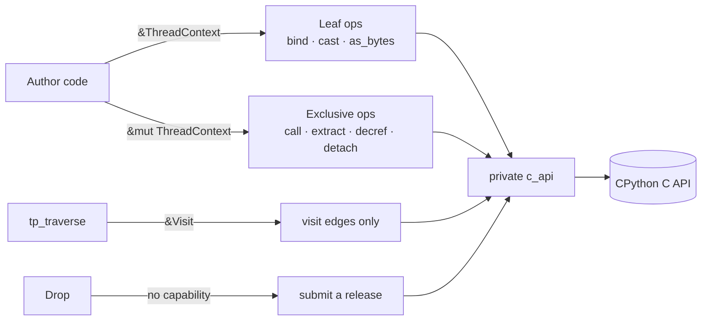

<div class="why">
Attachment, interpreter identity and reentrancy are carried in types, so
leaf operations don't re-check thread state on every call.
</div>

---

# `ThreadContext<'py>`

A scoped, exclusive capability for **one exact thread state** on the current OS thread.

<div class="grid grid-cols-2 gap-6">
<div>

```rust
pub struct ThreadContext<'py> {
    ptr: NonNull<ffi::PyThreadState>,
    interpreter: InterpreterKey,
    entry: NonNull<EntryState>,
    _marker: PhantomData<(
        fn(&'py ()) -> &'py (), // invariant 'py
        *mut (),                // !Send + !Sync
    )>,
}
```

- Not `Copy` or `Clone`
- Only generated entry glue creates one
- `'py` is a **fresh brand per entry**

</div>
<div>

```rust
// Private entry point, used by generated glue
unsafe fn with_current<R>(
    f: impl for<'py> FnOnce(
        &mut ThreadContext<'py>,
    ) -> R,
) -> Result<R, EntryError>;
```

```rust
// Illustrative: scoped values can't escape
let leaked = with_current(|ctx| {
    PyBytes::new(ctx, b"hi")
});
// error: `R` cannot name the
// higher-ranked lifetime `'py`
```

</div>
</div>

<div class="why">
An "any thread state in this interpreter" check isn't enough: the exception state belongs to the exact thread state.
</div>

---

# Shared vs. exclusive access

| Context | Allowed | Examples |
| --- | --- | --- |
| `&ThreadContext<'py>` | Audited **leaf** operations: no callbacks, no deallocators, no safepoints | `bind`, casts, `as_bytes`, audited incref |
| `&mut ThreadContext<'py>` | Anything that can run Python, decref, allocate reentrantly, or change attachment | extraction, object creation, attribute access, `detach` |

```rust
fn checksum<'py>(
    ctx: &mut ThreadContext<'py>,
    data: Borrowed<'_, 'py, PyBytes>,
) -> PyResult<Bound<'py, PyAny>> {
    let bytes = data.as_bytes(ctx);   // leaf: reborrows &*ctx
    let crc = crc32(bytes);           // plain Rust
    crc.into_pyobject(ctx)            // exclusive: may allocate or reenter
}
```

<div class="why">
Arbitrary Python can reenter, detach, or run finalizers. That must never happen while a shared borrow of the context is alive somewhere.
</div>

---

# Why exclusivity matters: PyO3 #2141 / #3640

In PyO3, `SendWrapper` and scoped TLS let code reach Python **while detached**.

<div class="grid grid-cols-2 gap-6">
<div>

Stash a shared context reference anywhere: TLS, a struct, a wrapper…

```rust
let shared: &ThreadContext<'py> = &*ctx;
stash_somewhere(shared);

ctx.detach(|| {
    from_stash().call_python();
});
// error[E0502]: cannot borrow `*ctx` as
// mutable because it is also borrowed
// as immutable
```

</div>
<div>

Hold a `RefCell<&mut ThreadContext>` instead?

```rust
cell.borrow_mut().detach(|| {
    // `detach` holds the &mut loan for
    // its whole call, so this panics
    // instead of aliasing:
    cell.borrow_mut().call_python();
});
```

A foreign library calling `PyEval_SaveThread` directly?
→ CPython's **transition gate** (next slides)

</div>
</div>

---

# Suspension and the availability flag

Holding `&mut ctx` doesn't make the context unusable. Private wrappers **suspend** it only around the reentrant C call.

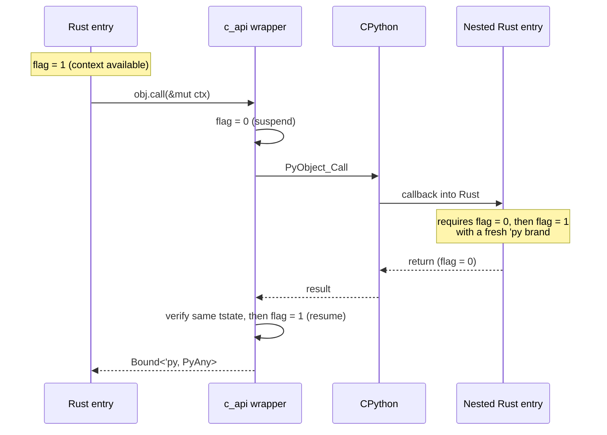

<div class="text-sm opacity-80">
One flag per OS thread, kept in CPython because each extension links its own copy of the Rust crate. It's thread-local, so no atomics are needed.
</div>

---

# The transition gate

Rust borrowing can't stop *another* library from detaching, so CPython checks the flag.

<div class="grid grid-cols-5 gap-6">
<div class="col-span-3">

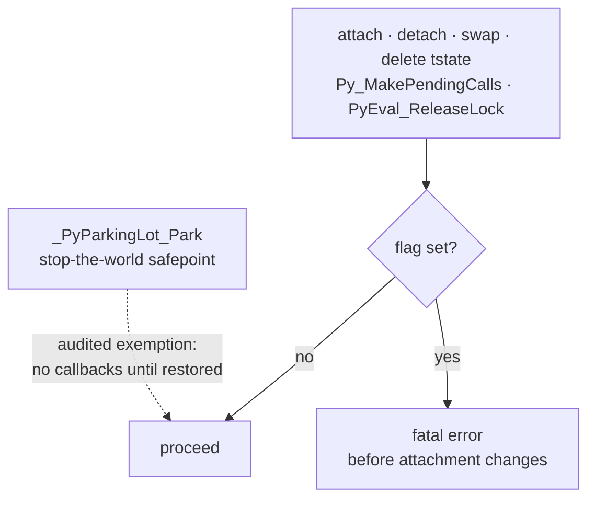

</div>
<div class="col-span-2 text-sm">

- The gate costs **one load and branch**, next to the current-tstate pointer
- Each tstate has an atomic **protection count**, so a suspended entry's state can't be deleted
- Foreign code running Python *without* detaching ends at a Rust boundary that checks the flag: fatal error or safe leak, **never UB**

<div class="why">
Continuing would break safe Rust's proof, and waiting on the same thread would deadlock.
</div>

</div>
</div>

---

# Detaching

```rust
let input = data.as_bytes(ctx);        // exact bytes: immutable, safe to read detached
let output = ctx.detach_if_possible(|| deflate(input, level));
```

| Method | Behaviour | Use for |
| --- | --- | --- |
| `detach` | Detaches, or returns `DetachError` **before** running `f` | waiting on other threads |
| `detach_if_possible` | Detaches if the phase allows, otherwise runs attached; `f` runs exactly once | pure computation |
| `interop` | Suspends but stays attached; a foreign wrapper manages attachment | PyO3 and other bindings |

- No `Send` bounds on closures: they run on the same thread, and the proof is the exclusive borrow
- The interpreter lease and thread-state protection cover the whole detached interval

<div class="why">
Detaching is refused during finalization. Compression is fine attached, but waiting on another thread while attached can deadlock (GIL or stop-the-world).
</div>

---

# Three handle types

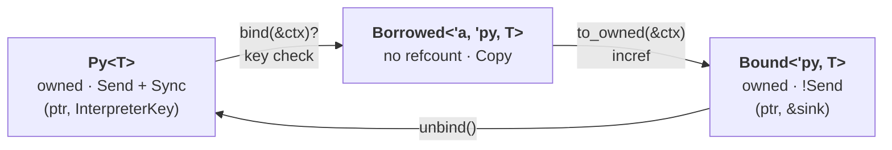

```rust
let stored: Py<PyType> = exception_type.unbind();
let current = stored.bind(ctx).map_err(|e| e.raise(ctx))?;  // InterpreterMismatch?
let retained: Bound<'py, PyType> = current.to_owned(ctx);
```

- No `Clone`: `clone_ref(ctx)` / `to_owned(ctx)` make every incref visible
- Both owning forms are two words on 64-bit targets
- Scoped handles share `'py` with the context, so there are no per-operation identity checks

---

# Interpreter keys

Every interpreter lifetime gets a fresh **64-bit generation number** from a counter that survives `Py_FinalizeEx`.

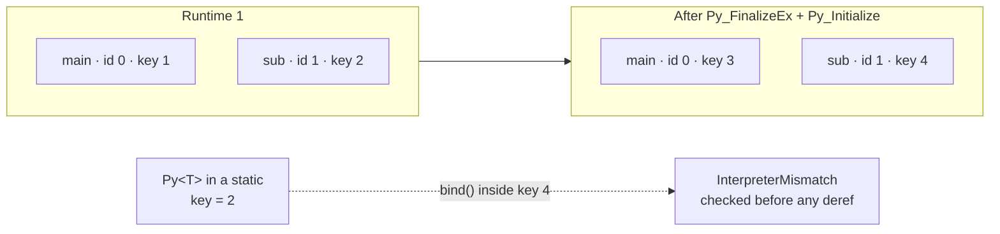

<div class="grid grid-cols-2 gap-6 text-sm">
<div>

**Why not interpreter IDs?** `next_id` resets on reinit, the main interpreter is always 0, and addresses get reused.

</div>
<div>

A key names the interpreter whose **API contract** a reference was acquired under. Immortality or pointer equality is never a licence to relabel a handle.

</div>
</div>

---

# Leases: why the whole entry?

A key doesn't keep its interpreter alive. Each Rust entry holds a **finalization lease** for its entire duration, even while detached.

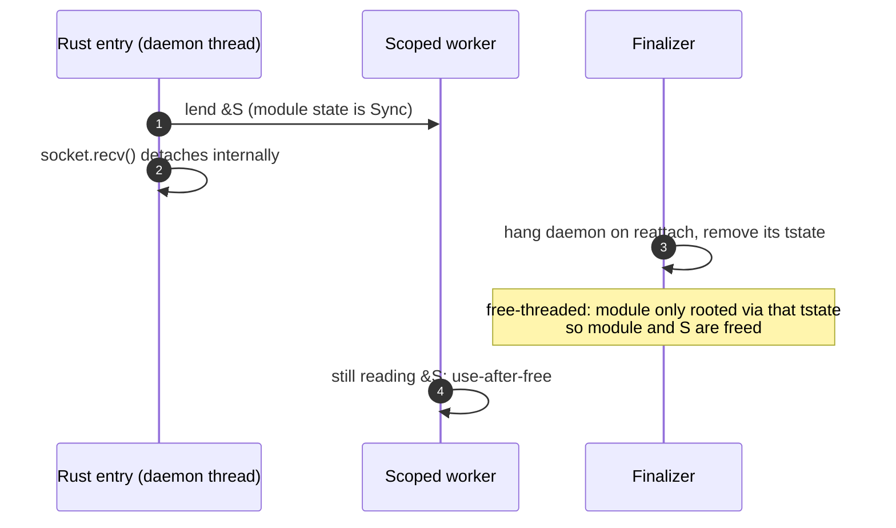

<div class="why">
Step 2 isn't an explicit Rust detach, and a bare <code>&S</code> has no destructor to release a lease of its own. Cost: an entry blocked forever in a callback blocks shutdown forever. This is deliberate.
</div>

---
class: dense
---

# Lease protocol

Each `PyThreadState` counts its **own** leases. PEP 788's shared CAS counter would make every Rust call write one shared cache line.

<div class="grid grid-cols-2 gap-6">
<div>

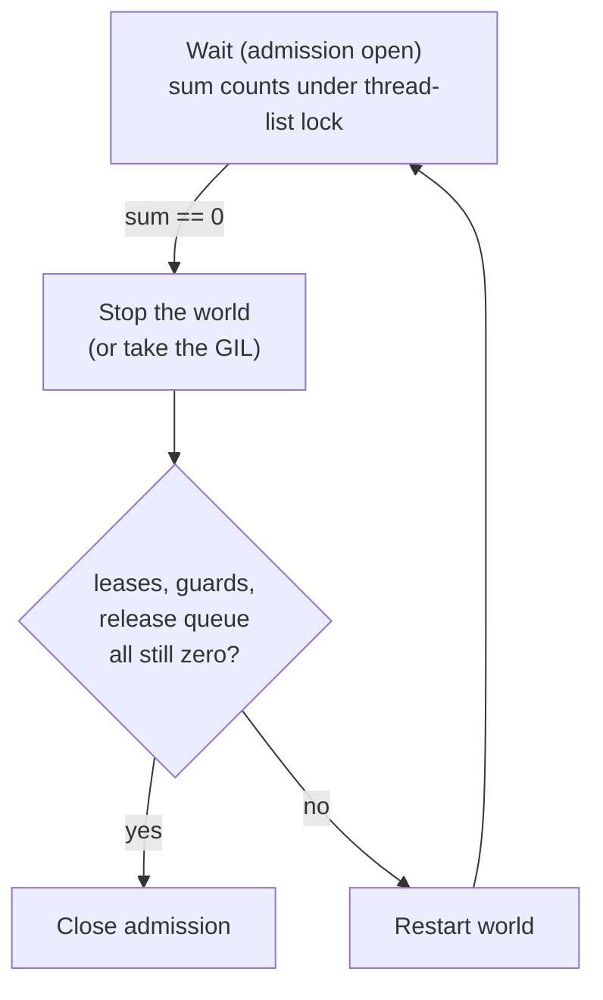

</div>
<div class="text-sm">

**Acquire:** read the admission flag, then `++tstate.leases` (no safepoint in between)

**Release:** `--leases`; at zero, wake the finalizer through a *process-global* wake word, because the interpreter may be freed immediately

**Fatal checks** instead of deadlock:
- finalizing an interpreter your own thread leases
- hanging a thread that holds *any* lease, since it may be leasing another interpreter

**Cleanup authorization:** after admission closes, only the finalizing thread state's callbacks may run

</div>
</div>

---

# `Drop` never decrefs

```rust
{
    let tmp = PyBytes::new(ctx, b"...")?;   // Bound<'py, PyBytes>
}   // Drop: push onto the entry's inline sink (no Python, no lock, no allocation)
```

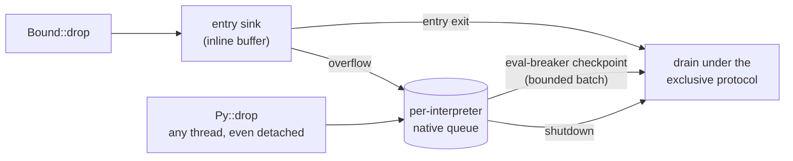

<div class="why">
A decref can run <code>__del__</code>: arbitrary Python, reentry, detach. <code>Drop</code> has no <code>&mut ctx</code> to prove that's safe. Use <code>obj.drop_with(ctx)</code> when it must go now.
</div>

---

# The release queue

```c
_PyDeferredReleaseResult _PyObject_TryDeferDecRef(
    _PyInterpreterKey interpreter, PyObject *owned_reference);
// → _Py_RELEASE_QUEUED | _CLOSED | _EXPIRED | _NO_MEMORY
```

<div class="grid grid-cols-2 gap-6">
<div>

**Submission**
- Callable from any thread: detached, in another interpreter, even after `Py_FinalizeEx`
- Never reads the object or its refcount
- Allocation must be Python-free. `PyMem_RawMalloc` is out, because under tracemalloc it calls `PyGILState_Ensure`
- Only `QUEUED` consumes the reference

</div>
<div>

**Failure means a safe leak**
- `CLOSED` / `EXPIRED` / `NO_MEMORY` → abandon the reference and log a diagnostic
- Never retried in another interpreter
- Safe Rust can `mem::forget` anyway, so correctness never depends on destructors

**Notification**
- All 8 eval-breaker bits are taken, so set `releases_pending` plus the calls-to-do bit

</div>
</div>

---

# Shutdown

<div class="grid grid-cols-5 gap-6">
<div class="col-span-2">

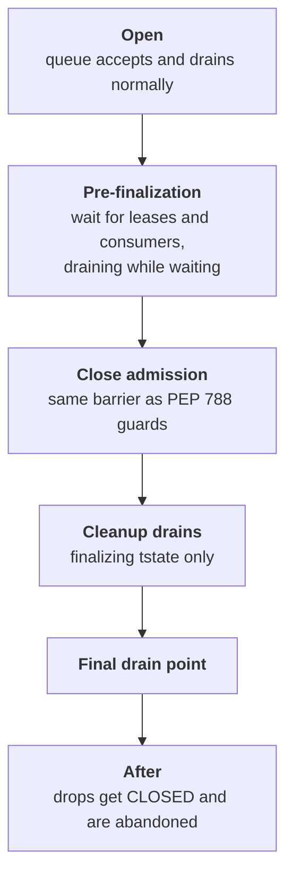

</div>
<div class="col-span-3">

- **Pre-finalization:** leased entries, nested callbacks and in-progress drain batches finish while the interpreter is intact
- **Close admission:** the final check covers queued releases and in-flight submissions too, with no check-then-enqueue gap
- **Cleanup drains:** run after module finalization, and before and inside interpreter clear (last GC, `gc.garbage`, warnings, `sysdict`, `builtins`)
- **Final drain point:** after `sysdict` and `builtins` are emptied, before the common constants are cleared. Every reference accepted before it is released; none is accepted after

<div class="why">
Once the common constants are cleared, running any bytecode is unsafe. Even an implicit <code>return None</code> loads one.
</div>

</div>
</div>

---

# Errors own their exception

```rust
#[must_use]
pub struct PyErr { exception: Py<PyBaseException> }

fn checked_size(ctx: &mut ThreadContext<'_>, size: usize) -> PyResult<i32> {
    i32::try_from(size)
        .map_err(|_| PyOverflowError::raise(ctx, "size is too large"))
}
```

- Nothing is pending on the thread state until the generated boundary restores it
- Dropping a `PyErr` leaves no hidden pending exception behind
- When a C call fails, the wrapper **immediately** takes the raised exception, a pointer transfer via `_PyErr_GetRaisedException`
- At the boundary the key is checked, and a foreign-interpreter error becomes `SystemError`

<div class="why">
An ambient "error is set" flag can't be tracked by the type system, and recovering in Rust would leave it set.
</div>

---
class: dense
---

# Modules

```rust
export_module! {
    name: _base64,
    doc: c"Base64 encoding implemented in Rust",
    state: Base64State,
    methods: [standard_b64encode],
    exec: base64_exec,
}

#[derive(ModuleStateGc)]
struct Base64State { error: GcSlot<PyType> }

#[pyfunction(signature = (data, /))]
fn standard_b64encode<'a, 'py>(
    ctx: &mut ThreadContext<'py>,
    _state: &Base64State,                 // typed per-module state
    data: Borrowed<'a, 'py, PyBytes>,
) -> PyResult<Bound<'py, PyBytes>> { /* ... */ }
```

- Uses PEP 793 `PyModExport` and `PySlot`
- `ModuleMethodDef<S>` must match the declared state, otherwise it's a type error
- Author expressions are bound to safe `const` items before any `unsafe` slot construction

---

# Module state lifecycle

Unexecuted modules are reachable (via `module_from_spec`, or `sys.modules` mid-import), so every callback must handle "no state yet".

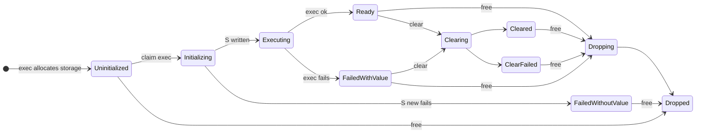

<div class="text-sm opacity-80">
Callbacks borrow <code>&S</code> only in <code>Ready</code>. Traversal is allowed in any phase where <code>S</code> is live. Guards apply the failure phases when a panic unwinds.
</div>

---
class: dense
---

# `GcSlot<T>`: traced Python edges

<div class="grid grid-cols-2 gap-6">
<div>

```rust
impl<T> GcSlot<T> {
    pub fn empty(ctx: &ThreadContext<'_>)
        -> Self;
    pub fn get<'py>(
        &self,
        ctx: &mut ThreadContext<'py>,
    ) -> Result<Option<Bound<'py, T>>,
                InterpreterMismatch>;
    pub fn replace<'py>(
        &self,
        ctx: &mut ThreadContext<'py>,
        value: Option<Bound<'py, T>>,
    ) -> Result<Option<Bound<'py, T>>,
                GcSlotReplaceError<'py, T>>;
}
```

- The key is fixed at construction and checked when the slot is published or mutated, because checking at GC time is too late
- GC clear **closes** the slot permanently, so reentrant code can't resurrect the edge
- A failed `replace` hands your value back untouched

</div>
<div>

**What the derive traces**

| Field type | Treatment |
| --- | --- |
| `GcSlot<T>` | traced |
| `Option` / `Box` / `Vec` / arrays of slots | traced per slot |
| `Arc` / `Rc<GcSlot>` | compile error (edge counted twice) |
| anything else | untraced, cycle leaks (safe) |

<div class="text-sm pt-2">
<code>ENABLED</code> is computed with <code>needs_drop</code>, because a type alias can hide a slot. Even <code>u64</code> can be shadowed!
</div>

</div>
</div>

---
class: dense
---

# Identity: unique statics and invariance

The address of a static `ClassDef` / `ModuleDef` is the **type token**. Two things can break that:

<div class="grid grid-cols-2 gap-6">
<div>

### 1. Merging

If two classes return `&CONST` with identical contents, the compiler may promote and merge them. They then share a token, and a payload gets read with the wrong layout.

**Fix:** a private `UnsafeCell` field. Const promotion becomes a compile error, and the compiler never merges statics that contain one.

</div>
<div>

### 2. Variance

```rust
fn keep(s: &'static str) { STASH.set(s) }

let ty: Bound<PyType<Payload<fn(&str)>>> = ..;
// fn(&str) <: fn(&'static str), so if
// PyType<T> were covariant this would compile:
let ty2: Bound<PyType<Payload<fn(&'static str)>>> = ty;
let obj = ty2.new_instance(ctx, Payload(keep))?;
let back = obj.downcast::<
    PyInstance<Payload<fn(&str)>>>()?; // token ✓
(back.get().0)(&String::from("temp")); // dangling
```

**Fix:** a `PhantomData<fn(T) -> T>` marker on every identity-bearing type

</div>
</div>

---
class: dense
---

# Classes

<div class="grid grid-cols-2 gap-6">
<div>

```rust
#[derive(PyClassGc)]
struct Node {
    parent: GcSlot<PyInstance<Node>>,
    value: u64,
}

impl PyClass for Node {
    type State = TreeState;
    type Gc = NodeGc;
    fn definition() -> &'static ClassDef<Self> {
        &NODE_CLASS
    }
}

static NODE_CLASS: ClassDef<Node> =
    ClassDef::new(c"tree.Node")
        .methods(Node::PY_METHODS);
```

</div>
<div>

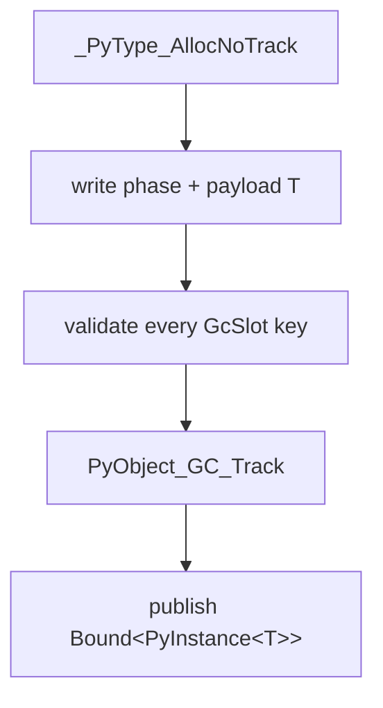

- One runtime type **per module instance**; there is no global type cache
- Methods take `&self` only, because aliases can call concurrently on free-threaded builds
- So mutable state needs interior mutability (`PyLock` is still a prototype)

</div>
</div>

<div class="why">
<code>PyType_GenericAlloc</code> tracks immediately, and debug builds traverse during tracking, before the Rust payload is initialized.
</div>

---
class: dense
---

# C API mistakes the Rust API rules out

| Common C API bug | How the Rust API prevents it |
| --- | --- |
| Missing or extra `Py_DECREF` | Owning handles; no `Clone`; increfs are explicit; `Drop` releases exactly once |
| Using a borrowed reference after its owner dies | `Borrowed<'a, 'py, T>` cannot outlive its owner `'a` |
| Calling the C API without an attached thread state | Every Python operation needs a `ThreadContext`; `detach` closures get none |
| Returning `NULL` without an exception, or a value with one set | `PyErr` owns its exception; the boundary checks the error indicator |
| Ignoring an error, or misreading an ambiguous `-1` | Wrappers capture errors immediately; `PyResult` is `#[must_use]` |
| Clobbering a propagating exception in `tp_dealloc` | Generated deallocators save and restore exception state |
| Casting to the wrong type (`PyBytes_AS_STRING` on a non-bytes) | Checked downcasts into typed markers |
| Missing `Py_VISIT` entries, or tracking before init | Derived GC policies; `GcSlot`; track only after initialization |
| Using module state before exec or after free | Typed `ModuleRef<S>`; state phases checked on every callback |
| Mixing objects from different subinterpreters | Interpreter key checked before any dereference |
| Unsynchronized state on free-threaded builds | Payloads and state must be `Send + Sync`; methods get `&self` only |

---
class: dense
---

# What if subinterpreters weren't supported?

Less than you might expect. Most of the machinery exists for free-threading, reentrancy, and shutdown.

<div class="grid grid-cols-2 gap-8">
<div>

### Goes away

- **Key checks:** `bind`, conversions and traced-field publication can't fail with `InterpreterMismatch`
- **Per-slot keys** in `GcSlot`, and key validation at publication
- **Foreign-error handling** at the callback boundary
- **Release queue registry:** one queue instead of one per interpreter, no endpoint retirement or `EXPIRED`
- **Cross-interpreter lease checks**, such as hanging a thread that leases another interpreter
- **`Py_MOD_PER_INTERPRETER_GIL_SUPPORTED`** and its audit of global state in native dependencies

`InterpreterKey` shrinks to a runtime generation, still needed for `Py_FinalizeEx` + reinit. If reinit is unsupported too, `Py<T>` drops to one word.

</div>
<div>

### Stays

- **`ThreadContext`**, shared vs. exclusive access, suspension, and the transition gate: needed for any thread state
- **Deferred release:** `Drop` can't decref because finalizers reenter
- **Leases and the shutdown protocol:** main-interpreter finalization still races daemon threads
- **`GcSlot` synchronization**, `Send + Sync` payloads, `&self` methods: free-threading
- **Module state phases:** `module_from_spec` and reloads still create unexecuted or extra instances
- **Exception ownership, panic containment, type identity**

</div>
</div>

---

# Open questions

- **Upstream CPython bugs**, reproducible without Rust:
  - PEP 788 guards held by threads lost in `fork()` hang the child's finalization
  - daemon threads in a subinterpreter ended by main finalization keep a dangling interpreter pointer
  - pending calls scheduled after the last `_Py_FinishPendingCalls` deadlock guard holders
- **Shutdown progress:** an entry blocked in a callback blocks shutdown. That's fine for `zlib`, but what about `functools`?
- **Buffer protocol:** a safe `PyBuffer` that can't race Python mutation
- **Locking:** finalize `PyLock`, and decide whether a `zlib` output buffer plus copy can beat `PyBytesWriter`
- **Static builds:** inittab support for `PyModExport_<name>`
- **Panic strategy:** require `panic=unwind`?

---
layout: center
class: text-center
---

# Discussion

Full design: `RUST_API.md`
